# Rapport de recette — instance « Resto Préprod » — 8 octobre 2026

| | |
|---|---|
| Application testée | https://pick-eat-go-white-label.vercel.app |
| API | https://pickeatgo-whitelabel.onrender.com (version déployée `938e6b4e3f`, branche `main`) |
| Mode | `APP_MODE=single`, fuseau Europe/Brussels, mention « propulsé par » affichée |
| Méthode | Parcours automatisés dans Chromium (12 tailles d'écran) + appels directs à l'API, avec des données marquées **TEST** |
| Comptes utilisés | Éditeur `scott.kula.kula@gmail.com` (rôle admin) ; clients de test `test-client-…@example.com` |

Les captures sont dans `captures/`, les résultats bruts dans `resultats-R1-R14.json`, `resultats-R4-R13.json`,
`journal-passe-1.txt` et `journal-passe-2.txt`.

## 1. Synthèse

| Scénario | Résultat | En un mot |
|---|---|---|
| R1 Site public multi-écrans | **OK** | 33 vues sur 12 tailles d'écran : aucun débordement horizontal, aucune erreur JavaScript, aucun champ de saisie < 16 px |
| R2 Installation sur l'écran d'accueil | **À faire sur vrai téléphone** | Manifest et icônes vérifiés (R8) ; l'installation elle-même ne se teste que sur iPhone / Android |
| R3 Commande à emporter + suivi en direct | **OK** | Compte, panier avec option, commande #4502, étapes reçues en 3 à 5 s, paiement carte, note 5 ★ |
| R4 Livraison (zones, minimum, frais) | **OK** | Hors zone refusé, minimum 15 € appliqué, frais 2,50 €, commande #4503 suivie jusqu'à « livrée » |
| R5 Code promo et fidélité | **OK** | RECETTE10 = −10 %, récompense fidélité après 3 commandes, non-cumul (code prioritaire), annulation client |
| R6 Pas d'inscription restaurateur, pas de création de restaurant | **OK** | Inscription avec rôle restaurateur refusée (400) ; création de restaurant refusée (401 / 403) |
| R7 Cloisonnement de l'instance | **OK** | Un identifiant de restaurant autre que celui de l'instance répond 404 ; les écrans de la place de marché (validation, contrats) sont absents |
| R8 « Mon application » visible sur le site | **OK** | Slogan, logo, réseaux, mentions légales et manifest reflètent la marque saisie |
| R9 E-mails de marque | **Non testable ici** | SMTP non configuré sur l'instance (fiche : « console, non envoyés ») |
| R10 Mode caissier (PIN employé) | **À faire par vous** | Nécessite le mot de passe du compte restaurateur (`scott-kula-kula@hotmail.be`) |
| R11 Interrupteur « fermé » | **OK** | Bandeau « Fermé », carte consultable, commande refusée par l'API (400), réouverture OK |
| R12 Console éditeur | **OK** | Fiche d'instance exacte, menus de la plateforme absents, utilisateurs limités à l'instance |
| R13 Plateforme PickEatGo inchangée | **OK** | https://pick-eat-go.vercel.app affiche toujours l'accueil multi-restaurants avec recherche |
| R14 Ergonomie tactile et lisibilité | **OK avec réserve** | Quelques cibles tactiles < 40 px dans le pied de page (corrigées dans ce lot, à déployer) |
| R15 Outillage de création d'instance | **OK en simulation** | `create_instance.py --dry-run` produit les 6 étapes attendues ; la création réelle demande vos clés Render / Vercel |

Bilan : **11 scénarios validés**, 1 validé avec réserve (R14), 1 validé en simulation (R15), 2 à réaliser sur vos
appareils ou après configuration (R2, R9), 1 en attente d'un accès (R10).

## 2. Détail par scénario

### R1 — Site public sur 12 tailles d'écran
Écrans : Android 320 px, Galaxy S8, iPhone SE, iPhone 14, Pixel 7, iPhone Max, téléphone en paysage, iPad mini,
iPad paysage, iPad Pro, portable 1366 px, bureau 1280 px. Pages : accueil, carte, à propos, mentions légales, connexion.

- Débordement horizontal : 0 sur les 33 vues.
- Erreurs JavaScript : 0 (une seule exception : à la première ouverture de la page de connexion, l'appel de santé de
  l'API a été bloqué par CORS pendant un réveil du service Render ; l'appel suivant est passé, l'en-tête CORS est présent).
- Aucun champ de saisie en dessous de 16 px sur mobile (pas de zoom automatique iOS).
- L'accueil ne montre ni recherche, ni filtres de cuisine, ni autre restaurant ; le pied de page et la mention
  « Application propulsée par PickEatGo » sont présents.
- La page de connexion n'a pas de sélecteur de rôle et porte le nom du restaurant.

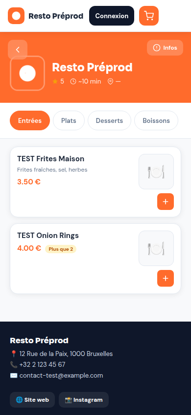
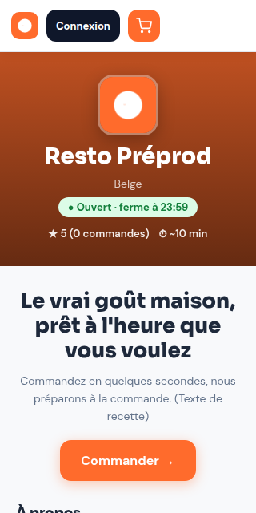
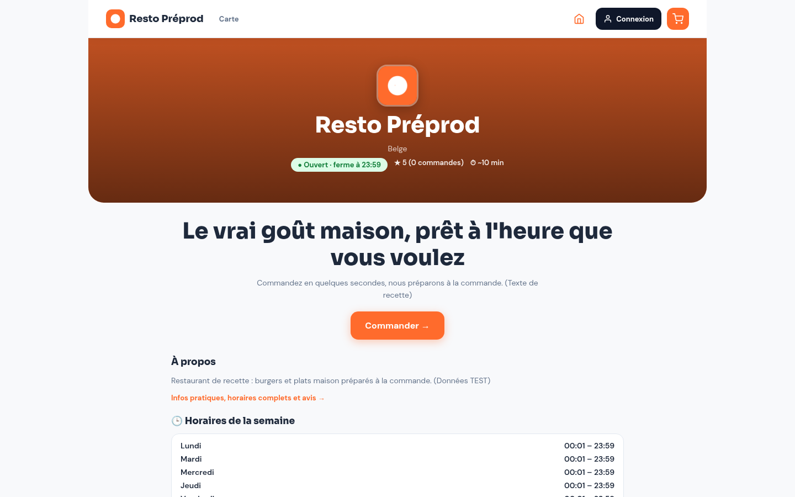
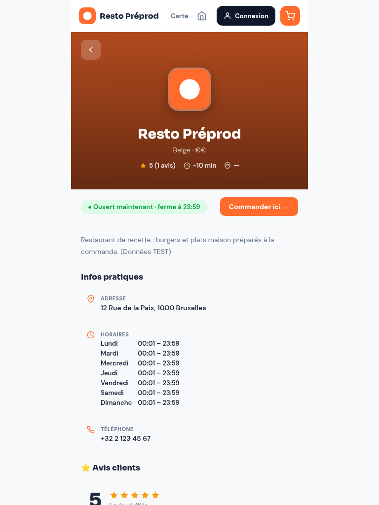
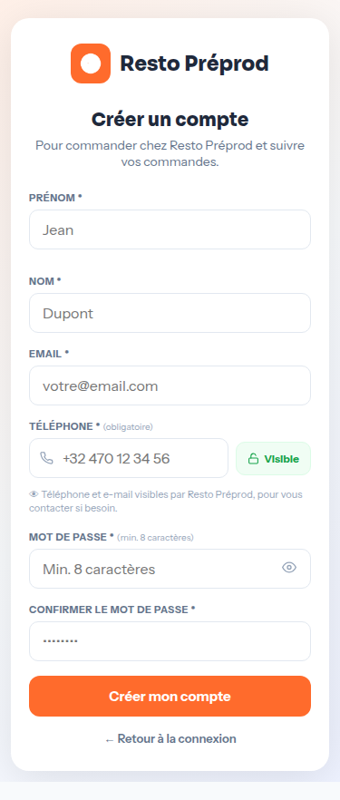

### R3 — Commande à emporter et suivi en direct
1. Création d'un compte client depuis l'API d'inscription (rôle client imposé) : 201.
2. Panier : « TEST Burger Classic » avec option Bacon (+1,00 €) et « TEST Frites Maison » ; commande #4502,
   total 14,00 € conforme (9,50 + 1,00 + 3,50).
3. Le restaurant (compte éditeur) fait avancer la commande ; côté client, sans recharger la page :
   « Confirmée » en 3,6 s, « En cuisine » en 4,6 s, écran « Prête à récupérer » en 4,5 s, écran « Bon appétit » en 5,0 s.
4. Remise avec paiement **carte** : statut `recuperee`, paiement enregistré, note 5 ★ et commentaire envoyés.
5. Aucune erreur JavaScript pendant le parcours.

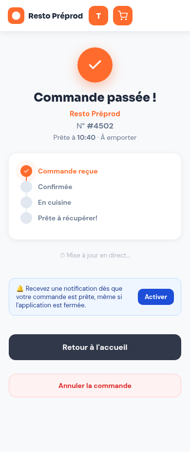
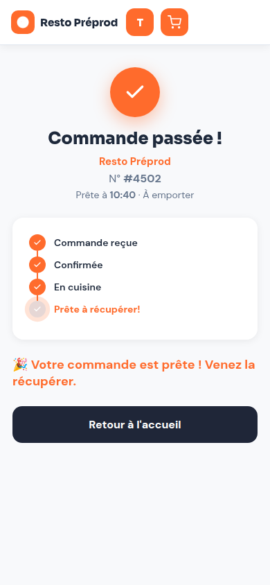
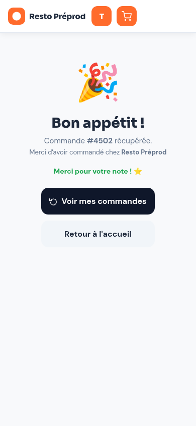

### R4 — Livraison
Réglages de test : zones 1000 et 1050, frais 2,50 €, minimum 15 €, offerts dès 40 €.

- Code postal 9999 : message « Nous ne livrons pas encore le code postal 9999 », bouton désactivé « Adresse non desservie ».
- Code postal 1000 avec 2,50 € de panier : bouton « Minimum 15,00 € pour la livraison », frais 2,50 € annoncés.
- Panier à 23,50 € : commande #4503 créée avec adresse, code postal, frais 2,50 €, total 26,00 €.
- Cycle complet : prête → « En livraison » affiché chez le client en moins d'une seconde → livrée (paiement espèces).

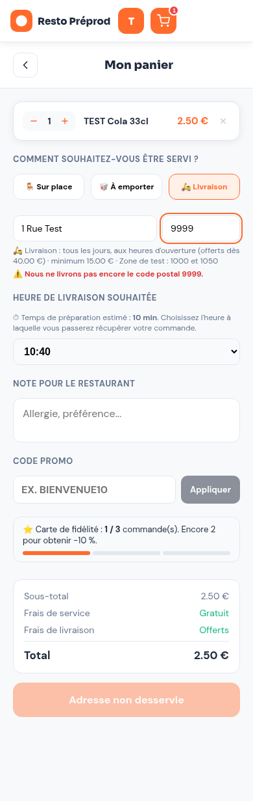
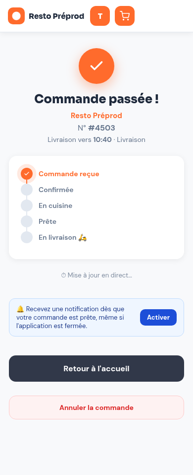
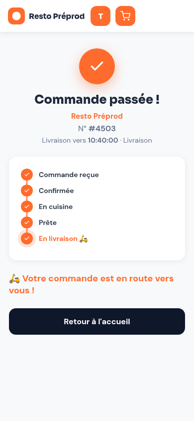
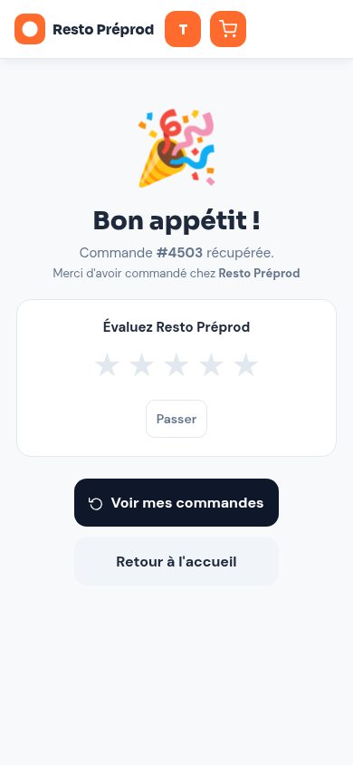

### R5 — Code promo et fidélité
Réglages de test : code RECETTE10 (−10 %), fidélité 3 commandes → −10 %.

- Commande #4504 avec RECETTE10 : remise 1,00 € sur 10,00 €, total 9,00 €, une seule remise.
- Après 3 commandes remises (#4502, #4503, #4504) : « Récompense fidélité prête ! » dans le panier, −0,95 € appliqués.
- Code promo saisi en plus : le code prend la place de la récompense, message « non cumulable avec un code promo,
  le code est prioritaire », une seule ligne de remise.
- Commande #4506 passée avec le code puis annulée par le client tant qu'elle est « nouvelle » : statut `annulee`,
  tampons conservés (3/3).
- Commande #4507 passée avec la récompense : `loyalty_reward = true`, remise 0,95 €, compteur remis à 0 après remise.

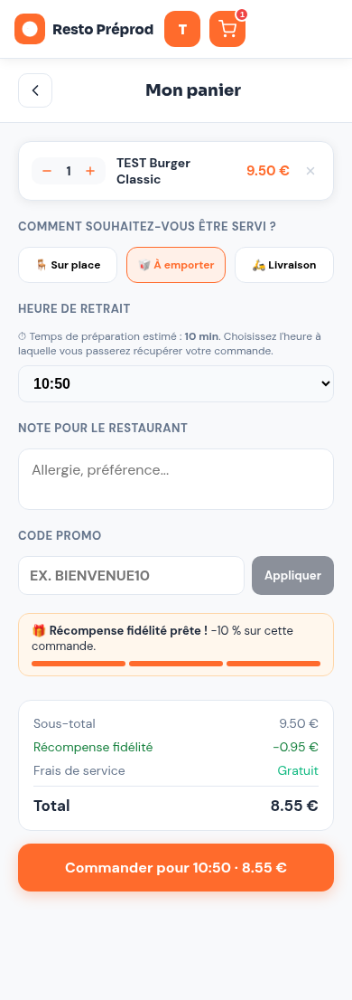
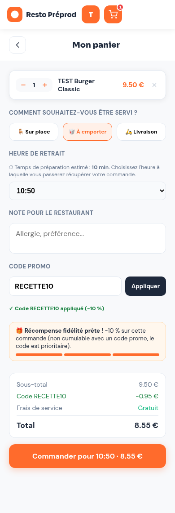

### R6 / R7 — Périmètre mono-restaurant
- Inscription avec `role=restaurateur` : 400. Création d'un restaurant par un client : 401 / 403.
- Toute requête visant un identifiant de restaurant autre que celui de l'instance répond 404 ; les routes de la place de marché (validation des restaurants, contrats) répondent 404.

### R8 — « Mon application » visible sur le site
- Slogan « Le vrai goût maison, prêt à l'heure que vous voulez », logo dans la barre, boutons Site web et Instagram.
- Mentions légales : raison sociale, numéro d'entreprise, TVA, siège, responsable, téléphone, e-mail.
  Les conditions de commande et la politique de confidentialité sont encore « en cours de rédaction »
  (textes à saisir dans Mon application → Textes légaux ; des modèles sont fournis dans `docs/modeles-legaux.md`).
- Manifest : nom « Resto Préprod », nom court « Resto Prépro », 3 icônes Cloudinary (192, 512, maskable),
  raccourcis « Commander » et « Mes commandes ».

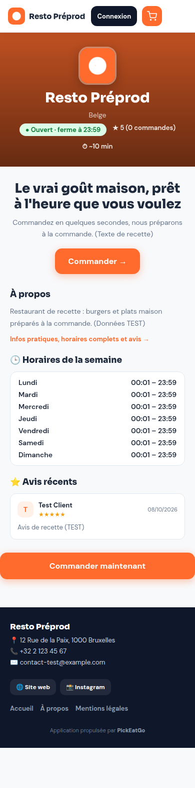
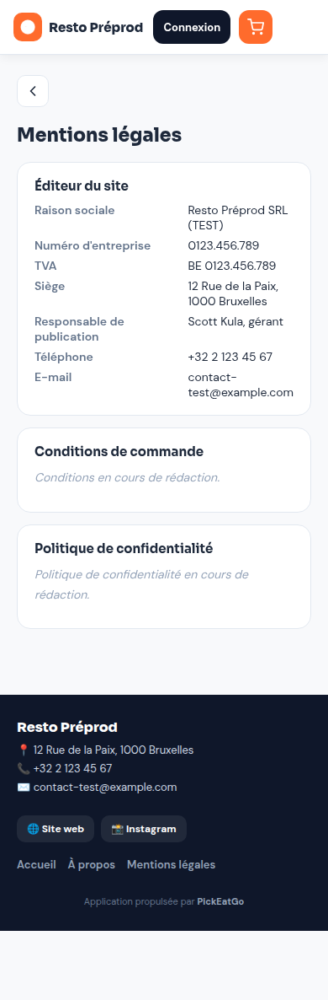

### R11 — Interrupteur « fermé »
Interrupteur basculé par l'API : accueil « ● Fermé », bouton « Fermé · voir la carte → », bandeau « Le restaurant
n'accepte pas de commande pour le moment », commande refusée (400, « Ce restaurant est actuellement fermé »).
Réouverture : « Ouvert · ferme à 23:59 ».

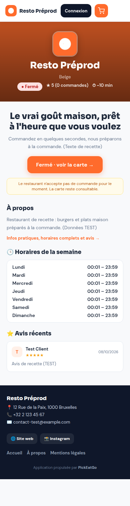

### R12 — Console éditeur
Menu : Dashboard, Instance, Utilisateurs, Signalements, Statistiques, Paramètres (pas de Restaurants ni de Contrats).
Fiche d'instance : application, restaurant, titulaire, mise en service, identifiant, domaine, API, version
`938e6b4e3f (main)`, dernier démarrage, services (Postgres, Redis, Cloudinary OK ; SMTP non configuré ; VAPID OK).
Utilisateurs : uniquement le restaurateur et les clients de test de l'instance.

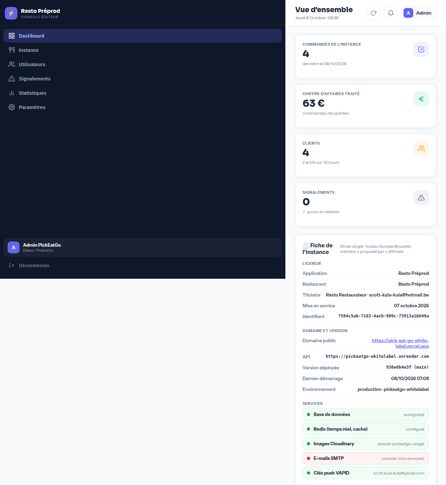
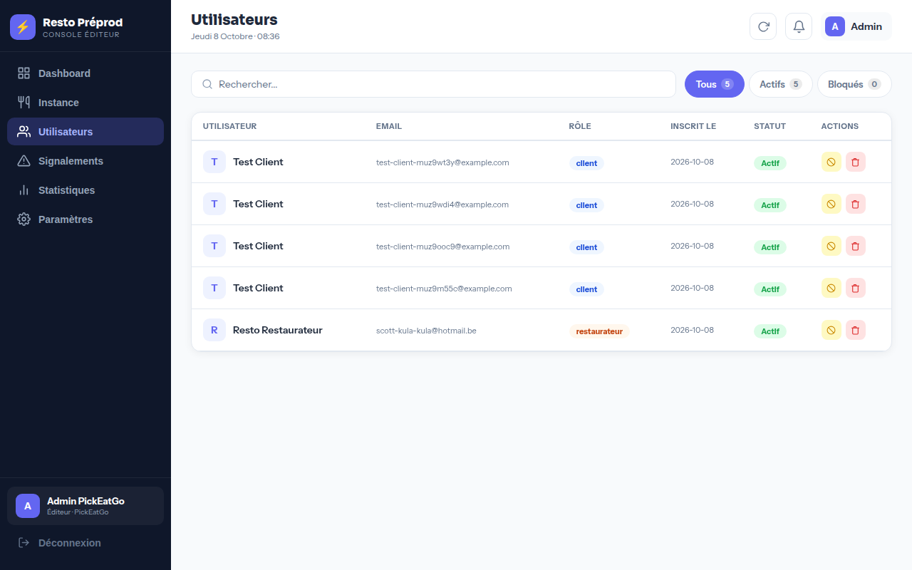

### R13 — Plateforme inchangée
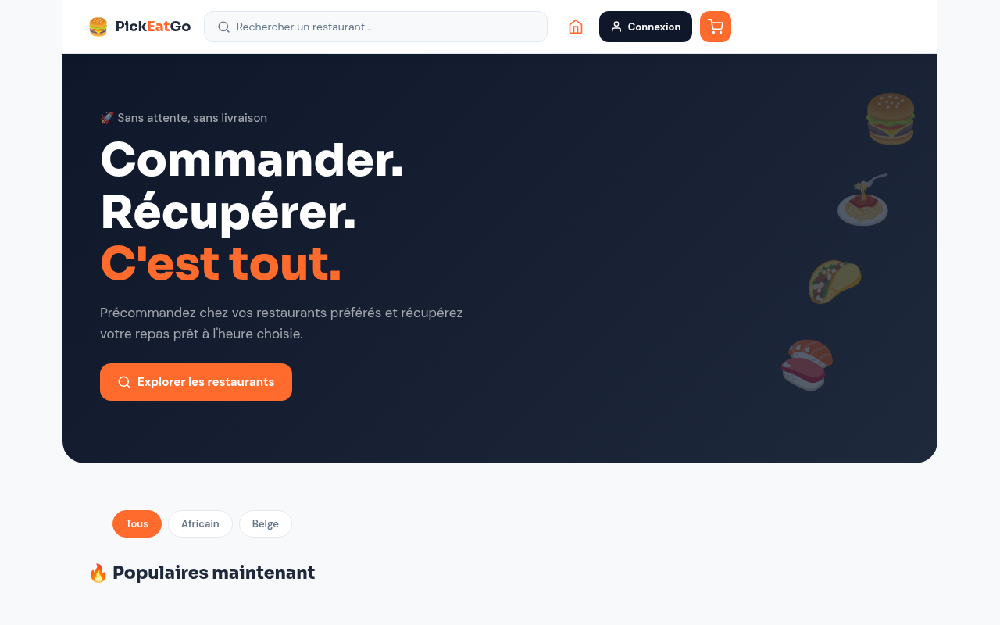

### R15 — Outillage (simulation)
`python tools/create_instance.py tools/instances/example.json --dry-run` affiche les appels prévus : Postgres,
Key Value, service web avec toutes les variables d'instance, job `bootstrap_tenant --restaurant-id …`,
déploiement initial, deux cron jobs, projet Vercel et domaine, puis la fiche de registre. Aucun appel réel n'a été fait.

## 3. Anomalies trouvées et corrections (branche `claude/modest-carson-hlgwyd`)

| # | Constat | Correction |
|---|---|---|
| A1 | Pied de page : liens téléphone / e-mail (17 px) et boutons Accueil / À propos / Mentions légales (29 px) sous les 40 px recommandés ; idem « Infos pratiques, horaires complets et avis → » | Hauteur minimale 40 px sur ces éléments (`frontend/app/single.jsx`) |
| A2 | Taper `/#menu` ou `/#legal` dans la barre d'adresse alors que le site est déjà ouvert ramenait à l'accueil | Le changement d'ancre est maintenant lu depuis l'URL (`frontend/lib/useHistoryPage.js`) |
| A3 | Un client en livraison qui rechargeait la page pendant l'étape « En livraison » perdait l'écran de suivi | L'étape 4 est restaurée comme les autres (`frontend/app/page.jsx`) |
| A4 | L'accueil affichait « ★ 5 (0 commandes) » : le compteur de commandes du restaurant n'était jamais incrémenté | Incrément à chaque commande remise au client (`backend/apps/orders/models.py`) |
| A5 | Le journal technique de la fiche d'instance restait vide (0 entrée) même après des erreurs 500 | Les erreurs de requêtes, de sécurité et de base alimentent le journal (`backend/pickeatgo/settings_prod.py`) |

Vérifications faites avant envoi : build Next.js OK, 139 tests en mode single et 140 tests en mode plateforme passés.

### Anomalie ouverte
**Photos de plat et photos du lieu : erreur 500 en production** (`POST /menus/items/{id}/upload-image/` et
`POST /restaurants/{id}/photos/`), alors que les envois du logo et des icônes vers Cloudinary fonctionnent et que
le même code répond 200 en local. Le journal d'instance était vide (A5). Après déploiement de ce lot, refaire un envoi
de photo depuis le tableau de bord puis lire le journal dans Console éditeur → Instance ; ou consulter les logs du
service sur Render au moment de l'envoi. Les plats de test ont été créés sans photo.

### Remarques mineures (non corrigées)
- Panier en livraison : tant que le code postal n'est pas desservi, la ligne « Frais de livraison » affiche « Offerts ».
- Écran de confirmation d'une livraison : « Livraison vers 10:40 · Livraison » répète le mot.
- Sur ordinateur, le bouton « + » des plats fait 28 px (à la souris, acceptable ; sur mobile le plat s'ouvre en plein écran).

## 4. Ce qui reste à faire par vous

1. **R2 — Installation** : sur un iPhone (Safari → Partager → Sur l'écran d'accueil) et un Android (Chrome → Installer) :
   icône, nom court, écran de démarrage, ouverture directe sur l'accueil du restaurant.
2. **Notifications push** : depuis le téléphone installé, activer « Recevez une notification… » sur l'écran de suivi
   puis faire avancer une commande depuis le tableau de bord : la notification doit arriver même application fermée.
3. **R9 — E-mails** : une fois le SMTP configuré (variables `EMAIL_*` sur Render), vérifier l'e-mail de bienvenue,
   de confirmation de commande et de réinitialisation de mot de passe (nom, logo et couleur du restaurant, pas de
   mention PickEatGo autre que le badge si activé).
4. **R10 — Mode caissier** : avec le compte restaurateur, Tableau de bord → Mode caissier, PIN 4826 (Sarah TEST,
   caissier) et 7391 (Marco TEST, gérant) ; vérifier les droits de chacun et le nom de l'employé sur la commande.
   Si vous me transmettez le mot de passe de `scott-kula-kula@hotmail.be`, je peux le faire.
5. **Impression** : ticket de commande et clôture de caisse sur votre imprimante.
6. **R15 — Création réelle d'une instance** avec `RENDER_API_KEY` et `VERCEL_TOKEN` (voir `docs/12-creer-une-instance.md`).
7. **Textes légaux** : saisir les conditions de commande et la politique de confidentialité (modèles fournis),
   ce qui termine la liste de publication.
8. **Reportés à plus tard (déjà notés)** : domaine personnalisé (étape 9) et cron jobs `stock_digest` / `weekly_report`
   (étape 10, après le SMTP).
9. **Sécurité** : changer le mot de passe de l'éditeur et du restaurateur après la recette (ils ont circulé par écrit).

## 5. Données de test à supprimer après la recette

- Clients : `test-client-muz9m55c@example.com`, `test-client-muz9ooc9@example.com`, `test-client-muz9wdi4@example.com`,
  `test-client-muz9wt3y@example.com` (Console éditeur → Utilisateurs).
- Commandes #4501 à #4507 (historique ; elles comptent dans le chiffre d'affaires affiché : 63 € puis 71,55 €).
- Plats « TEST … » (9), code promo RECETTE10, employés Sarah TEST et Marco TEST, zones de livraison 1000 / 1050.
- Textes « (TEST) » dans Mon application (slogan, à propos, mentions légales) et horaires 00:01–23:59.
- Un avis 5 ★ « Avis de recette (TEST) ».
